# t3_act8_eq03 — Control Alumnos

**Programación Web · 09:00 - 10:00 am**

Sistema web de control escolar con tres roles (administrador, docente y estudiante). Frontend en React (Vite), backend en Spring Boot 3.5 / Java 21 y base de datos PostgreSQL, desplegado en un VPS con HTTPS.

## Integrantes
- Arcadio Aparicio Ingrid
- Hernández Guzmán Concepción Escarleth

## Enlaces del proyecto

| Qué | Dónde |
|---|---|
| Sistema desplegado (frontend) | https://t3act8eq03.tech/t3_act8_eq03/ |
| URL base del API (backend) | `https://t3act8eq03.tech/api` |
| Repositorio público | https://github.com/Ingridthv/t3_act8_eq03 |
| GitHub Projects (tablero) | https://github.com/users/Ingridthv/projects/2 |
| Prototipo en Figma | https://www.figma.com/design/SI5pp5ecnies5WhIKvoe6w/ControlAlumnos---Sistema-de-Alumnos--Mockup-?node-id=0-1&p=f&t=M1JqRxvLrdaRpScS-0 |
| Colección de Bruno | carpeta [`bruno/ControlAlumnos/`](bruno/ControlAlumnos/) de este repositorio |
| Respaldo en GitHub Pages | https://ingridthv.github.io/t3_act8_eq03/ |

## Usuarios de prueba

Las contraseñas están guardadas en PostgreSQL cifradas con BCrypt.

| Rol | Correo | Contraseña |
|---|---|---|
| Administrador | `admin@controlalumnos.edu.mx` | `Admin2027!` |
| Docente | `samuel.ortiz@escuela.edu.mx` | `Docente2026!` |
| Estudiante | `20168978@escuela.edu.mx` | `Alumno2026!` |

## Tecnologías

| Capa | Tecnología |
|---|---|
| Frontend | React + Vite, React Router (HashRouter) |
| Backend | Spring Boot 3.5.0, Java 21, Spring Security, JdbcTemplate y JPA |
| Base de datos | PostgreSQL + Flyway (migraciones V1 a V6) |
| Seguridad | JWT sin estado, BCrypt, roles por ruta |
| Correo | JavaMailSender + Postfix (SPF, DKIM y DMARC) |
| SMS y WhatsApp | Twilio |
| Servidor | Nginx + Certbot (HTTPS), JAR con systemd |
| Pruebas de API | Bruno |
| Diseño | Figma |

## Qué hace el sistema

**Administrador**
- Gestiona alumnos, docentes, materias, grupos, periodos, carreras, inscripciones, calificaciones y usuarios.
- Al dar de alta a un alumno o docente, el sistema crea su cuenta y le envía por correo su usuario y una contraseña temporal.
- Panel de inicio con total de alumnos, activos y promedio general, y reportes.

**Docente**
- Ve sus grupos (con filtros por periodo y carrera), los alumnos de cada grupo y captura parcial y final.
- Solo puede calificar a alumnos de sus propios grupos.

**Estudiante**
- Ve su resumen, sus materias del periodo, sus calificaciones, su historial y su perfil.

**Para todos los roles:** inicio de sesión por correo, cambio obligatorio de contraseña en el primer acceso, recuperación de contraseña por correo y cierre de sesión que invalida el token.

### Flujo académico

El administrador sigue este orden, y cada paso depende del anterior:

1. **Materia:** catálogo con clave única, nombre, créditos, semestre y carrera.
2. **Grupo:** une una materia con un docente, un horario, un cupo y una letra, en un periodo. Una materia puede tener varios grupos con distinto docente y horario; la clave de la materia no cambia.
3. **Inscripción:** inscribe al alumno en un periodo (una por periodo).
4. **Asignar materias:** el administrador elige para cada inscripción los grupos disponibles (mismo periodo, con cupo y sin repetir materia).
5. **Calificación:** el docente captura parcial y final; el estatus (aprobado, reprobado o pendiente) lo calcula la base de datos.

## Seguridad

- **JWT:** cada token lleva un identificador (`jti`), el usuario, el correo y el rol, y vence a los 60 minutos.
- **Roles:** `/api/admin/**` solo para administrador, `/api/docente/**` solo para docente y `/api/estudiante/**` solo para estudiante.
- **Logout con invalidación:** al cerrar sesión, el `jti` se guarda en la tabla `tokens_invalidados` y el token deja de funcionar aunque no haya vencido.
- **Contraseñas:** se guardan con BCrypt. Reglas: mínimo 8 caracteres, una mayúscula, un número y un carácter especial.
- **Recuperación de contraseña:** se envía un enlace por correo; en la base de datos solo se guarda el hash del token, vigente 30 minutos y de un solo uso. La respuesta es la misma exista o no el correo.
- **SQL seguro:** todas las consultas usan parámetros, nunca texto del usuario dentro del SQL.
- **Errores:** `@RestControllerAdvice` devuelve todos los errores en el mismo formato JSON.

Formato de error:

```json
{
  "timestamp": "2026-11-23T22:00:00Z",
  "status": 400,
  "error": "Bad Request",
  "message": "Hay datos que corregir.",
  "path": "/api/admin/materias",
  "errors": { "clave": "Usa el formato ABC-123 (3 letras, guion y 3 números)." }
}
```

| Código | Cuándo |
|---|---|
| 400 | Datos inválidos o regla de negocio incumplida |
| 401 | Credenciales incorrectas o falta el token |
| 403 | Cuenta inactiva o rol sin permiso |
| 404 | El registro o la ruta no existen |
| 409 | Dato repetido o registro relacionado con otros |
| 500 | Error inesperado |

## API

URL base: `https://t3act8eq03.tech/api`

Todas las rutas, salvo login y recuperación, llevan el encabezado `Authorization: Bearer <token>`.

| Grupo | Rutas principales |
|---|---|
| Autenticación | `POST /auth/login`, `GET /auth/me`, `POST /auth/logout`, `POST /auth/cambiar-password`, `POST /auth/recuperar`, `POST /auth/restablecer` |
| Administrador | `/admin/alumnos`, `/admin/docentes`, `/admin/materias`, `/admin/grupos`, `/admin/periodos`, `/admin/carreras`, `/admin/inscripciones`, `/admin/calificaciones`, `/admin/usuarios`, `/admin/resumen`, `/admin/reportes` |
| Asignar materias | `GET/POST /admin/inscripciones/{id}/materias`, `GET /admin/inscripciones/{id}/grupos-disponibles`, `DELETE /admin/inscripciones/{id}/materias/{cargaId}` |
| Docente | `GET /docente/perfil`, `GET /docente/grupos/pagina`, `GET /docente/grupos/{id}/alumnos`, `GET /docente/grupos/{id}/reporte`, `PUT /docente/calificaciones/{cargaId}` |
| Estudiante | `GET /estudiante/resumen`, `/estudiante/perfil`, `/estudiante/periodos`, `/estudiante/materias`, `/estudiante/calificaciones` |

**Paginación y filtros en el servidor.** Las listas reciben `page` (desde 0), `size` (máximo 50) y filtros como `q`, `carrera`, `periodo` o `estatus`, y responden:

```json
{ "items": [], "page": 0, "size": 10, "total": 0, "totalPages": 1 }
```

**Paginación en pantalla.** Las tablas muestran 10 registros por página, con botones para avanzar, regresar y elegir página. La página queda en la URL (por ejemplo `?page=2`), así que el enlace se puede compartir y funciona el botón de regresar del navegador.

### Colección de Bruno

En [`bruno/ControlAlumnos/`](bruno/ControlAlumnos/) están las peticiones de prueba de la API, organizadas por carpetas:

| Carpeta | Qué prueba |
|---|---|
| `01 - Autenticacion` | Login de los tres roles, consultar sesión, cambiar contraseña, recuperar, restablecer y cerrar sesión |
| `02 - Carreras` | Consultar con paginación, registrar, actualizar y eliminar |
| `03 - Docentes` | Perfil, grupos con filtros, alumnos de un grupo, reporte y captura de calificaciones |
| `04 - Estudiantes` | Resumen, perfil, periodos, materias y calificaciones |
| `05 - Pruebas de roles` | Rutas `ping` de cada rol, para comprobar que cada uno entra solo a lo suyo |

Para usarla: abrir Bruno, *Open Collection*, elegir la carpeta `bruno/ControlAlumnos/`, seleccionar el entorno y ejecutar primero los tres logins de `01 - Autenticacion`. Cada login guarda su token y las demás peticiones lo usan. El entorno de producción apunta a `https://t3act8eq03.tech`.

Inicio de sesión de los tres roles contra la VPS (respuesta `200 OK`; el token se oculta en las capturas):

### Login Docente
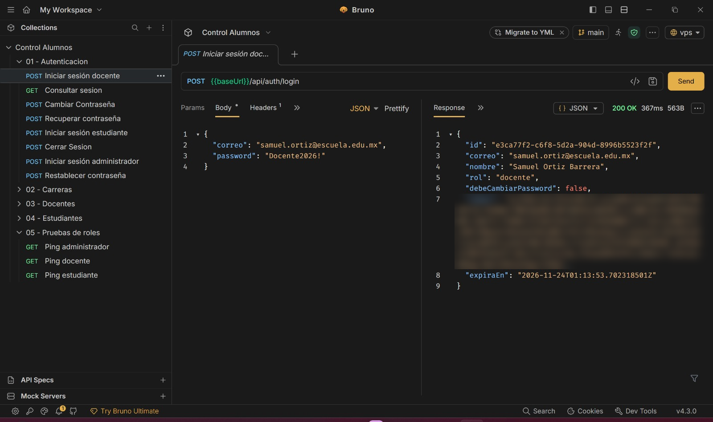

### Prueba docente
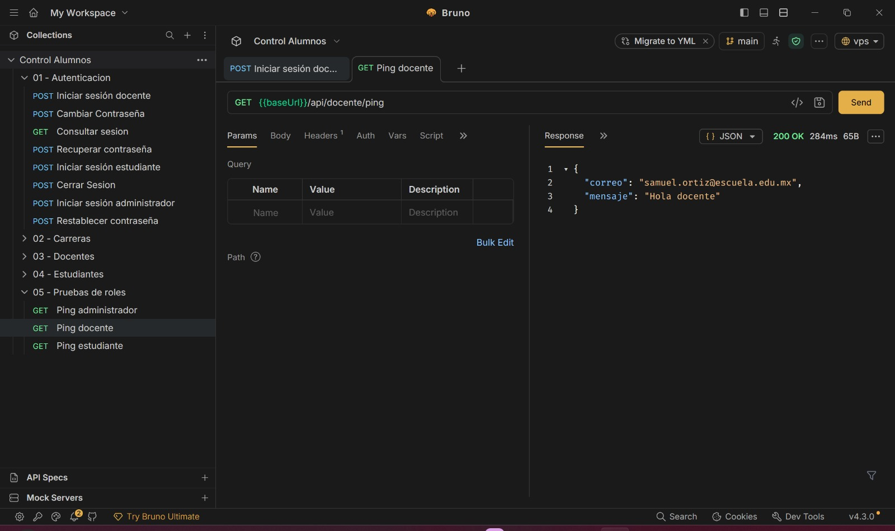

### Login Estudiante
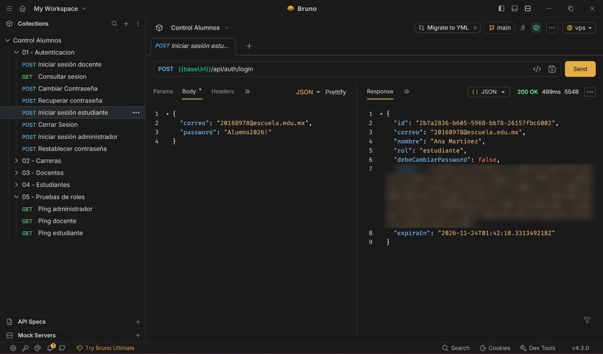

### Prueba Estuduante
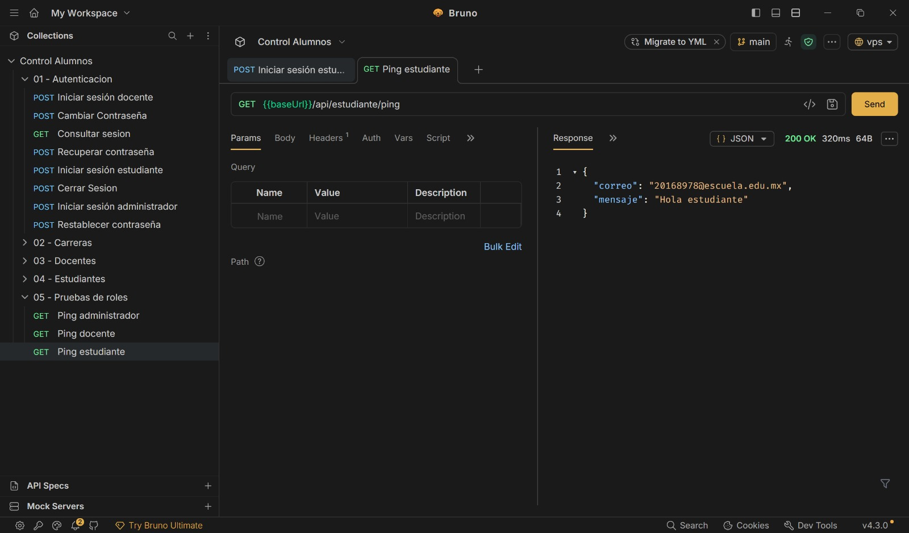

### Login Administrador
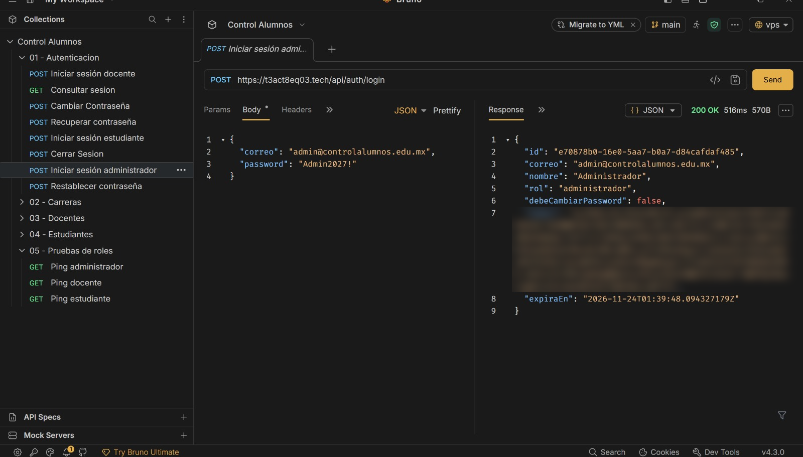

### Prueba Administrador
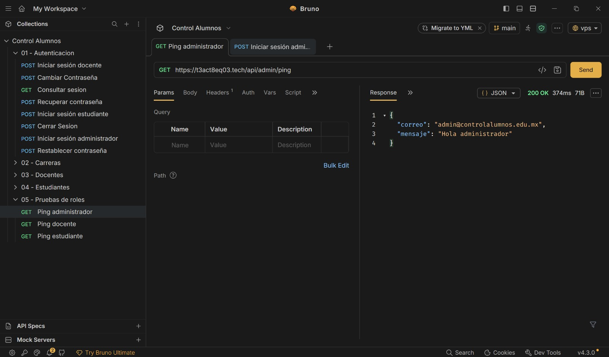

## Correo con Postfix (SPF y DKIM)

El backend envía los correos con `JavaMailSender` hacia Postfix en la misma VPS (`localhost:25`). El remitente es `no-reply@t3act8eq03.tech`. Se envía correo al crear una cuenta (usuario y contraseña temporal) y al recuperar la contraseña.

Gmail muestra **SPF, DKIM y DMARC en PASS** en el correo recibido:

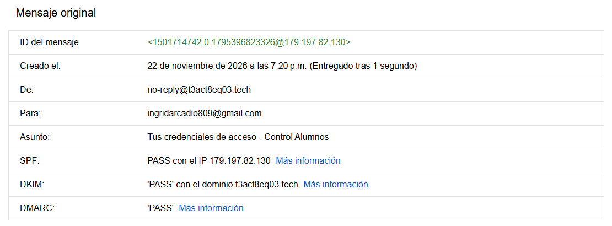

> En dominios nuevos, Gmail puede enviar los primeros correos a Spam. Si no llega a la bandeja, buscar `from:no-reply@t3act8eq03.tech` en "Todos los mensajes" y marcar "No es spam".

## SMS y WhatsApp con Twilio

Cuando un usuario **cambia o restablece su contraseña**, el sistema le envía un aviso por SMS y por WhatsApp (`NotificacionService`). El envío se hace después de guardar el cambio y en segundo plano.

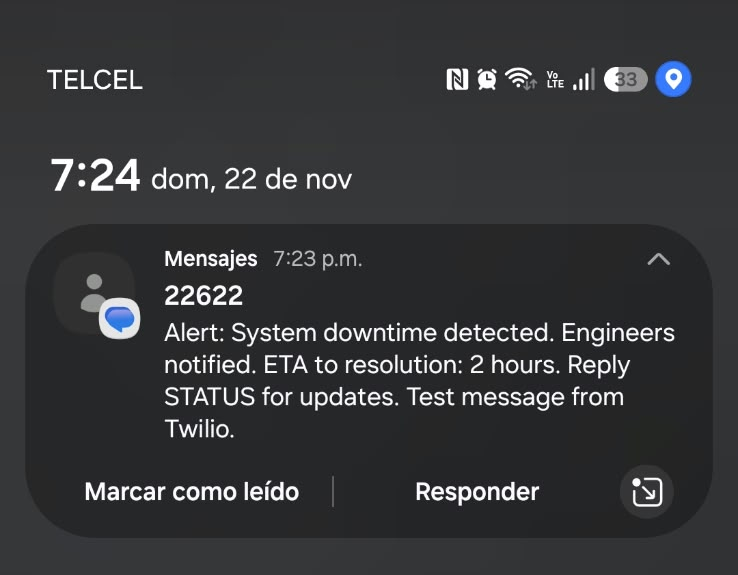

**Limitación de la cuenta de prueba (trial) de Twilio:**
- El SMS solo permite una plantilla predefinida (`sms_internal_alerts`), por eso el texto que llega es el de Twilio ("System downtime detected... Test message from Twilio").
- WhatsApp responde el error 21654 (`ContentSid Required`) hasta contar con una plantilla aprobada. No es un fallo del código.

## Base de datos

Flyway aplica las migraciones al arrancar el backend (`backend/src/main/resources/db/migration/`):

| Migración | Qué hace |
|---|---|
| `V1__esquema_inicial.sql` | Tablas, dominio de calificación (0 a 10), índices y vistas |
| `V2__datos_prueba.sql` | Datos semilla (docentes, alumnos, materias, grupos, calificaciones) |
| `V3__correo_contacto.sql` | Correo de contacto del usuario |
| `V4__catalogo_carreras.sql` | Catálogo de 8 carreras |
| `V5__telefono_contacto.sql` | Teléfono de contacto para SMS y WhatsApp |
| `V6__nombre_usuario_admin.sql` | Nombre visible del administrador |

**Respaldo:** [`database/respaldo_control_alumnos.sql`](database/respaldo_control_alumnos.sql). Para restaurarlo en una base vacía:

```bash
createdb control_alumnos
psql -d control_alumnos -f database/respaldo_control_alumnos.sql
```

### Diagrama entidad-relación

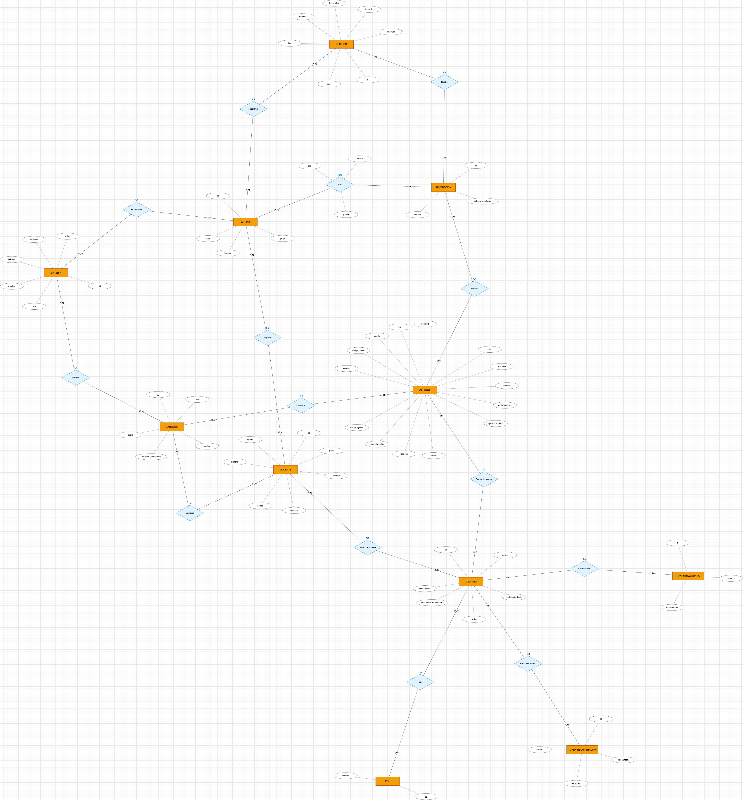

Relaciones principales:
- `roles` 1:N `usuarios`; cada usuario es administrador o apunta a un alumno o a un docente.
- `carreras` 1:N `alumnos` y 1:N `materias`.
- `materias` 1:N `grupos`; cada grupo pertenece a un periodo y a un docente, y es único por materia, periodo y letra.
- `alumnos` 1:N `inscripciones`, una por periodo.
- **N:M** entre `inscripciones` y `grupos`, mediante la tabla intermedia `cargas_academicas`.
- `cargas_academicas` 1:1 `calificaciones`.
- `tokens_invalidados` y `tokens_recuperacion` dependen de `usuarios`.

## Ejecutar en local

**Requisitos:** Java 21, Maven, Node.js y PostgreSQL.

**1. Base de datos**
```sql
CREATE DATABASE control_alumnos;
```

**2. Backend**
```bash
cd backend/src/main/resources
cp application.properties.example application.properties
# editar application.properties: conexión a PostgreSQL, app.jwt.secret (32+ caracteres),
# correo y Twilio (opcionales)
cd ../../..
mvn clean spring-boot:run
```
El backend queda en `http://localhost:8080`. Sin `spring.mail.host`, los correos se imprimen en la consola.

**3. Frontend**
```bash
# en la raíz del proyecto, crear el archivo .env con:
# VITE_API_URL=http://localhost:8080/api
npm install
npm run dev
```
La app queda en `http://localhost:5173`.

> `application.properties` contiene secretos y está en `.gitignore`; el repositorio solo incluye `application.properties.example`.

## Despliegue en el VPS

| Pieza | Detalle |
|---|---|
| Backend | JAR en `/opt/control-alumnos/`, servicio systemd `control-alumnos`, puerto interno 8080 |
| Configuración de producción | `application.properties` junto al JAR, fuera del repositorio |
| Base de datos | PostgreSQL en la VPS (`control_alumnos`) |
| Frontend | Archivos estáticos en `/var/www/html/t3_act8_eq03/` |
| Nginx | Sirve el frontend y pasa `/api` al backend |
| HTTPS | Certificado de Certbot para `t3act8eq03.tech` |

Actualizar el backend:
```bash
mvn clean package
scp backend/target/control-alumnos-api.jar root@179.197.82.130:/opt/control-alumnos/
# en la VPS:
systemctl restart control-alumnos
```

Actualizar el frontend (en PowerShell):
```powershell
$env:VITE_API_URL="https://t3act8eq03.tech/api"
npm run build
scp -r dist\* root@179.197.82.130:/var/www/html/t3_act8_eq03/
```
`vite.config.js` usa `base: '/t3_act8_eq03/'`.

## Origen de los datos y APIs externas

Todos los datos del sistema vienen del backend propio (Spring Boot + PostgreSQL), con paginación, búsqueda y filtros en el servidor. No hay datos ficticios: si la base está vacía, las pantallas se muestran vacías.

Servicios externos, solo para validar o decorar:
- **Disify:** verifica que el correo sea válido y no desechable.
- **Zippopotam.us:** obtiene el estado a partir del código postal.
- **Have I Been Pwned (Pwned Passwords):** avisa si la contraseña apareció en filtraciones.
- **Random User:** fotografías ilustrativas de los alumnos; si no carga, se muestran las iniciales.

## Interfaces de Figma

### Login
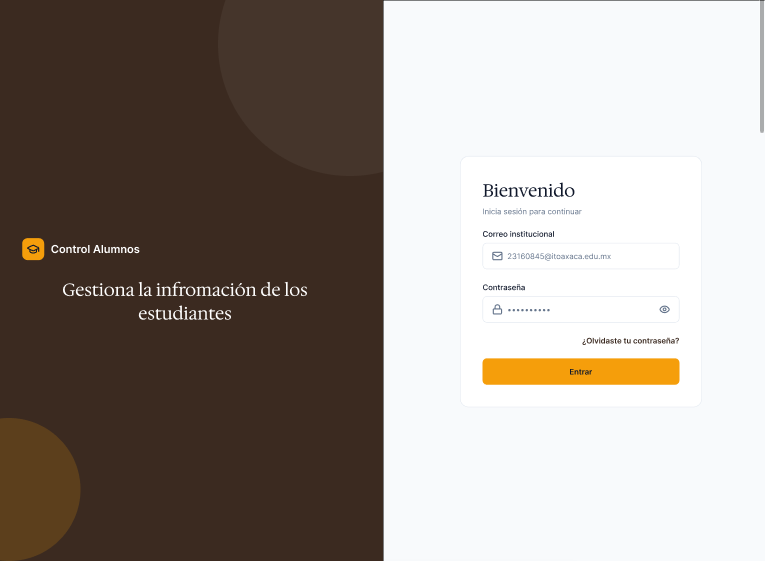

### Inicio
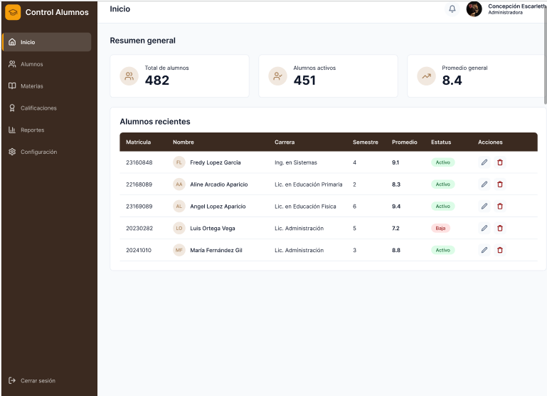

### Alumnos
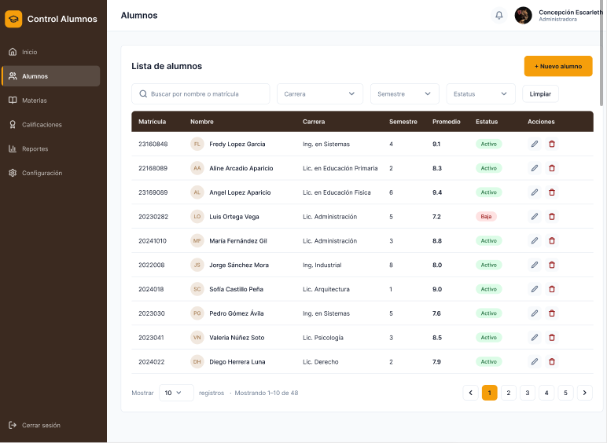

## Estructura del proyecto

```
backend/src/main/java/mx/edu/controlalumnos/
  config/       SecurityConfig (rutas por rol, CORS, BCrypt)
  security/     JwtService, JwtAuthFilter, manejadores 401 y 403
  controller/   Auth, Docente, Estudiante, Carreras
  admin/        Controladores y servicios del administrador, CuentaService, ConsultaSql
  service/      AuthService, PasswordService, MailService, NotificacionService, TwilioService
  dto/          Peticiones, respuestas, PageResponse, ApiError
  exception/    GlobalExceptionHandler y excepciones propias
  model/, repository/
backend/src/main/resources/
  db/migration/ V1 a V6
  application.properties.example
bruno/ControlAlumnos/  Colección de pruebas de la API
database/       Respaldo .sql
docs/           Diagrama ER y evidencias
src/
  components/   layout (Sidebar, Navbar, rutas protegidas) · ui · academico · users
  context/      AuthContext
  hooks/        useServerList
  pages/        Administrador · docente/ · estudiante/ · Login y recuperación
  services/     api.js · adminApi.js · validation.js
  utils/        entities.js (configuración de cada pantalla del administrador)
```

## Repartición del trabajo

### Arcadio Aparicio Ingrid (`Ingridthv`)
- Backend Spring Boot: inicio de sesión con JWT y roles, cierre de sesión con invalidación de token, cambio y recuperación de contraseña.
- Base de datos: migraciones de Flyway y conexión del módulo de administrador (materias, grupos, inscripciones y asignación de materias) y del módulo de estudiante.
- Pantallas del administrador en React y paginación en el servidor.
- Envío de correo con Postfix (SPF y DKIM) y de SMS y WhatsApp con Twilio.
- Despliegue en la VPS: JAR con systemd, Nginx y HTTPS.

### Hernández Guzmán Concepción Escarleth (`HernandezGuzmanConcepcionEscarleth`)
- Módulo del docente (backend y pantallas) e integración con el módulo de estudiante.
- Módulo de carreras: CRUD con paginación en el servidor.
- Colección de Bruno para pruebas de la API.
- Documentación: descripción de las APIs utilizadas y revisión del README.
- Estructura del repositorio: carpetas `database`, `migration` y `docs`.

El historial completo está en la pestaña de commits del repositorio.