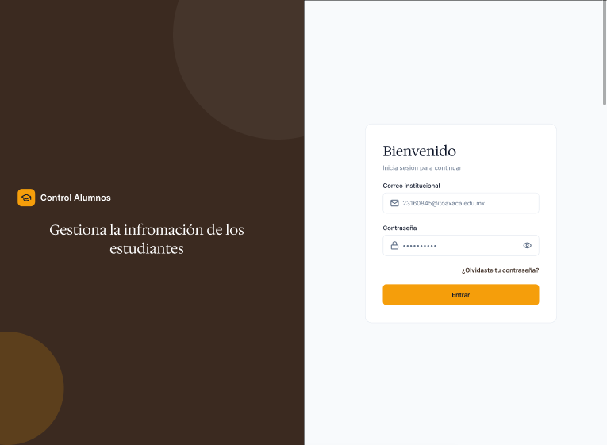
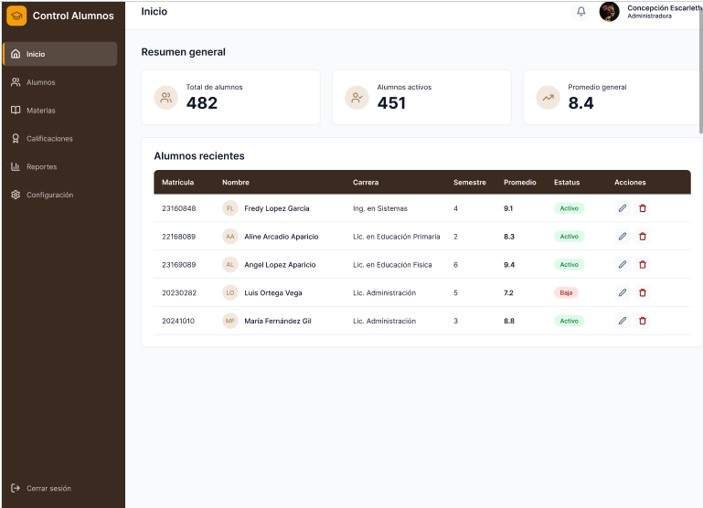
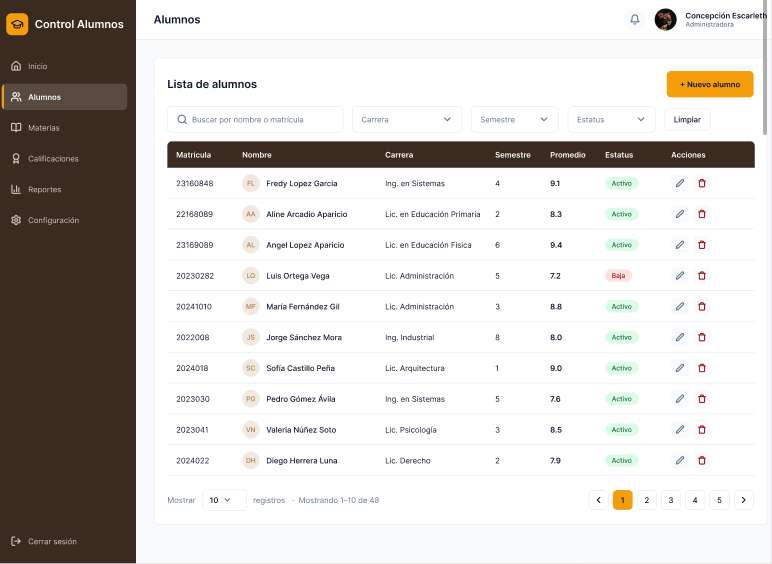

# t3_act8_eq03 — Control Alumnos

**Programación Web · 09:00 - 10:00 am**

Mini sistema en React (Vite) basado en el mockup de Figma de la Actividad 7.

## Integrantes
- Arcadio Aparicio Ingrid
- Hernández Guzmán Concepción Escarleth

## Proyecto desplegado
**VPS:** http://179.197.82.130/t3_act8_eq03/

**Respaldo en GitHub Pages:** https://ingridthv.github.io/t3_act8_eq03/

**Usuario de prueba:** `emilys` · **Contraseña:** `emilyspass`
(También funciona el correo `emily.johnson@x.dummyjson.com`).

## Descripción del proyecto
En esta actividad realizamos un sistema de control de alumnos utilizando React y Vite, tomando como referencia el mockup de Figma de la Actividad 7. Desarrollamos las tres pantallas principales del diseño: **Login**, **Inicio** y **Alumnos**.

El sistema permite iniciar sesión con validaciones, consultar la información de los alumnos, realizar búsquedas, aplicar filtros y administrar sus datos mediante las opciones de agregar, editar y eliminar.

Lo que incluye:
- **Login:** validación de los campos antes de enviarlos (vacíos, formato de correo), mensajes de error claros y acceso mediante la API de DummyJSON. Los datos del usuario se guardan en el estado de la aplicación.
- **Rutas protegidas:** si no se ha iniciado sesión no se puede ver el sistema; al cerrar sesión se regresa al login.
- **Sidebar y Navbar:** menú lateral de navegación y barra superior con la foto, el nombre y el botón de "Cerrar sesión".
- **Inicio:** resumen general con el total de alumnos, alumnos activos y promedio general, además de la lista de alumnos recientes.
- **Alumnos:** tabla con búsqueda por nombre o matrícula y filtros por carrera, semestre y estatus, además de paginación.
- **Carga y errores:** indicador de "cargando" mientras se obtienen los datos y mensaje de error con opción de reintentar si la petición falla.
- **Agregar, editar y eliminar:** cada acción hace primero la petición real a la API (POST, PUT, DELETE) y después refleja el cambio en el estado local para que la tabla se actualice. Editar y eliminar piden confirmación antes de ejecutarse.

## API de la tabla de datos
**DummyJSON usuarios** (`https://dummyjson.com/users`), usados como alumnos. Como la API no incluye datos académicos, la matrícula, la carrera, el semestre, el promedio y el estatus se generan a partir del id de cada usuario.

## APIs de validación y complementarias
- **DummyJSON** `/auth/login`: inicio de sesión.
- **Disify:** verifica que el correo sea válido y no desechable (formulario de alumnos).
- **Zippopotam.us:** del código postal obtiene el estado.
- **Have I Been Pwned (Pwned Passwords):** avisa si la contraseña apareció en filtraciones.
- **DiceBear:** foto de los alumnos creados desde la app.
- **Random User:** fotografías de los alumnos.

## Fotografías de los alumnos
Para mostrar las fotografías utilizamos Random User.

https://randomuser.me/

Este servicio proporciona fotografías reales de demostración. En nuestro código utilizamos el ID de cada alumno para asignarle una imagen diferente y seleccionar fotografías de hombres o mujeres.

Las imágenes se cargan directamente desde internet y, si alguna no se puede mostrar, aparecen las iniciales del alumno.

## Paginación
La tabla muestra 10 alumnos por página. Como trabajamos con 100 alumnos inicialmente, tenemos 10 páginas.

Agregamos botones para avanzar, regresar y seleccionar una página, y un selector para mostrar 10, 20, 40 o 50 registros por página. La página y el límite se reflejan en la URL (por ejemplo `?page=2&limit=20`), así que el enlace se puede compartir y funciona el botón de regresar del navegador.

## Ejecutar
```bash
npm install
npm run dev      # desarrollo
npm run build    # producción (carpeta dist/)
```

## Despliegue en el VPS
1. En `vite.config.js`, `base` es `'/t3_act8_eq03/'`.
2. `npm run build`
3. Se sube el contenido de `dist/` al servidor Nginx:
   `scp -r dist/* root@179.197.82.130:/var/www/html/t3_act8_eq03/`
4. Se abre `http://179.197.82.130/t3_act8_eq03/`.


### Interfaces Figma
### Login



### Inicio



### Alumnos



## Estructura
```
src/
  components/  layout/ (Sidebar, Navbar, rutas protegidas) · ui/ · users/
  context/     AuthContext (usuario en estado)
  hooks/       useUsers (carga y CRUD)
  pages/       LoginPage · DashboardPage · UsersPage
  services/    api.js · validation.js
  utils/
```

## Fotografías de los alumnos
```
Para mostrar las fotografías utilizamos Random User.

https://randomuser.me/

Este servicio proporciona fotografías reales de demostración. En nuestro código utilizamos el ID de cada alumno para asignarle una imagen diferente y seleccionar fotografías de hombres o mujeres.

Las imágenes se cargan directamente desde internet y, si alguna no se puede mostrar, aparecen las iniciales del alumno.
```

## Paginación
```
La tabla muestra 10 alumnos por página. Como trabajamos con 100 alumnos inicialmente, tenemos 10 páginas.

Agregamos botones para avanzar, regresar y seleccionar una página.
```